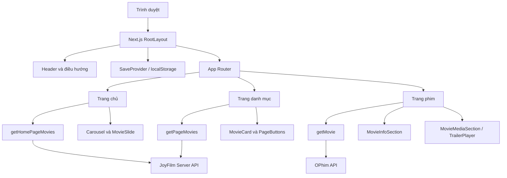
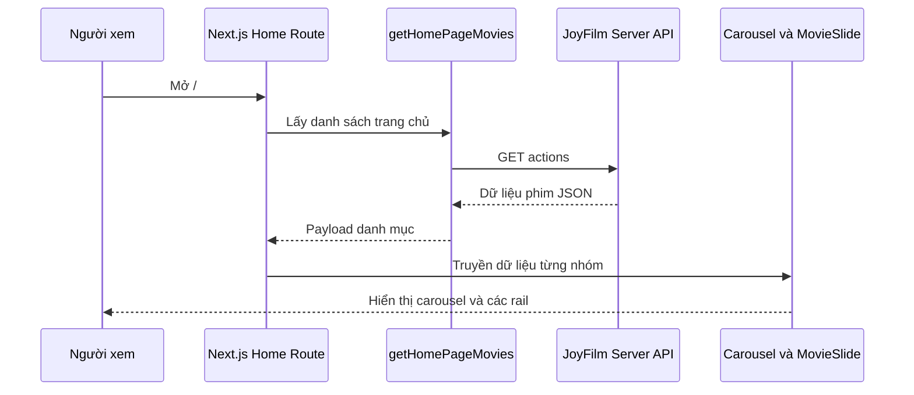
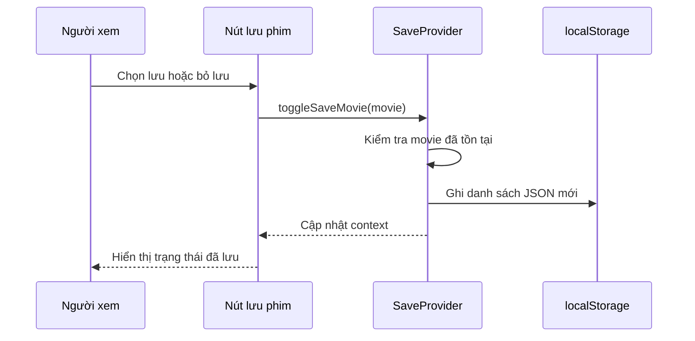

# Phân tích kiến trúc

## Architecture Analysis

### System Overview

Ứng dụng Next.js 13 dùng App Router. Route server components gọi các hàm trong `src/functions/` để lấy dữ liệu JSON từ dịch vụ bên ngoài; các phần cần tương tác trình duyệt được đánh dấu client component. `RootLayout` bao quanh route bằng Header, SaveProvider, nút danh sách đã lưu và Footer.

### Architectural Style

Frontend web đơn khối, render kết hợp server/client, dữ liệu phim do dịch vụ HTTP bên ngoài cung cấp. Không tìm thấy server/API backend trong repo `fe-web`.

### Component Relationships

Văn bản thay thế: route Next.js gọi các fetch helper tương ứng; dữ liệu đi từ JoyFilm Server hoặc OPhim đến các trang, còn danh sách đã lưu đi qua context và `localStorage`.

### Data Flow

- Trang chủ lấy một payload danh mục qua `getHomePageMovies`, sau đó truyền từng mảng phim xuống carousel và các `MovieSlide`.
- Trang danh mục lấy dữ liệu theo loại/trang qua `getPageMovies`, rồi render `MovieCard` và `PageButtons`.
- Trang chi tiết client tải phim theo slug qua `getMovie`; query `sv`/`tap` quyết định hiển thị thông tin hay phát tập.
- SaveProvider đọc/ghi danh sách phim trong `localStorage` và cung cấp thao tác lưu cho các component.

### Key Design Decisions

- Route danh mục dùng segment động `[page]`; chi tiết dùng `[slug]`.
- Tailwind token đặt trong `tailwind.config.js`; màu nền hiện tại là `#1a1a1a`, accent đỏ `#e50914`, accent phụ xanh `#0ea5e9`.
- Frontend gọi backend từ xa thay vì có API proxy nội bộ.

### Improvement Opportunities

- Bổ sung trạng thái lỗi và thử lại cho các yêu cầu dữ liệu phía client; chuẩn hóa thông báo lỗi fetch.
- Mã hóa query tìm kiếm và bảo vệ dữ liệu `localStorage` không hợp lệ.
- Không có cơ chế chọn theme/màu xanh trong repo này; phần nền cần tích hợp vào hệ thống theme nếu đó là mục tiêu của sản phẩm.

## Interaction Diagrams

### Tải trang chủ

Văn bản thay thế: yêu cầu trang chủ kích hoạt fetch helper, backend trả payload phim, rồi route truyền dữ liệu cho carousel và các dải phim.

### Lưu phim

Văn bản thay thế: nút gửi phim tới context; context cập nhật state và localStorage rồi UI phản ánh trạng thái mới.
