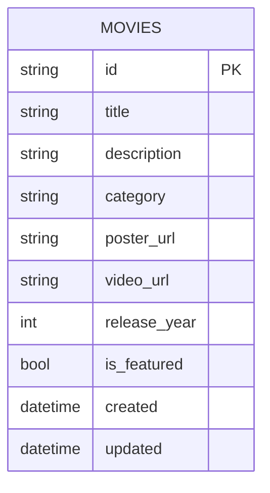
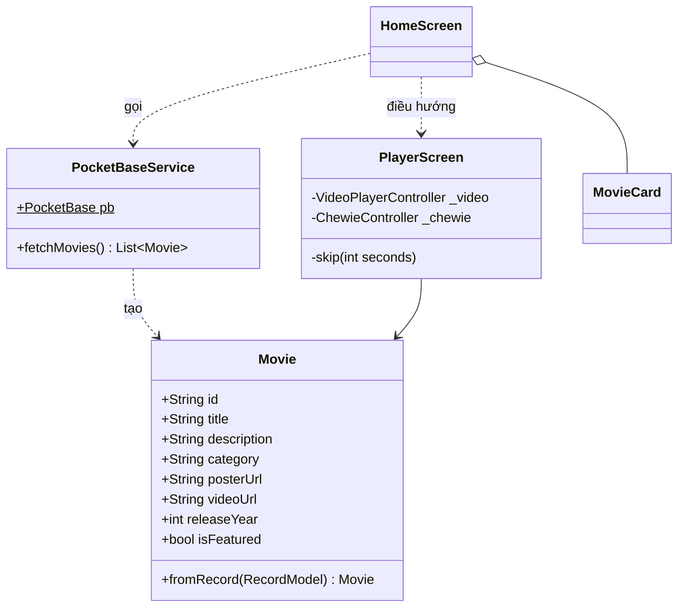
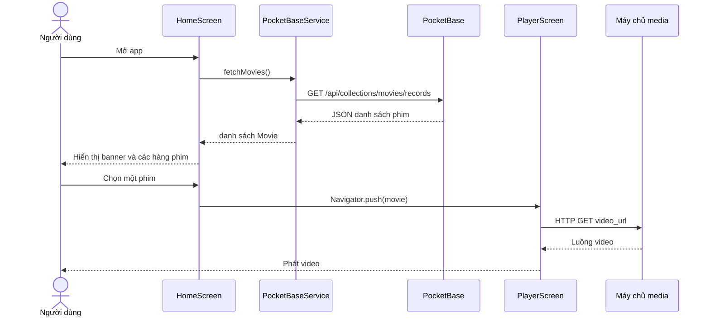

Mình phân tích theo thứ tự thường dùng trong báo cáo: yêu cầu, tác nhân, kiến trúc, dữ liệu, rồi luồng xử lý. Trước hết là kiến trúc tổng thể.Sơ đồ trên cho thấy hai điểm cần nhớ khi trình bày. Thứ nhất, app chỉ hỏi PocketBase để lấy metadata phim (tên, mô tả, link). Thứ hai, video và poster được tải thẳng từ máy chủ media chứ không đi qua PocketBase. Phần còn lại của phân tích như sau.

## 1. Phân tích yêu cầu

**Yêu cầu chức năng**

| Mã | Yêu cầu | Ưu tiên |
| --- | --- | --- |
| FR1 | Hiển thị danh sách phim lấy từ server | Bắt buộc |
| FR2 | Hiển thị banner các phim có `is_featured = true` | Bắt buộc |
| FR3 | Nhóm phim theo thể loại, mỗi thể loại là một hàng cuộn ngang | Bắt buộc |
| FR4 | Tìm phim theo từ khóa trong tên | Bắt buộc |
| FR5 | Xem chi tiết phim (poster, mô tả, năm, thể loại) | Bắt buộc |
| FR6 | Phát video: play/pause, tua ±10s, thanh tiến trình, toàn màn hình | Bắt buộc |
| FR7 | Quản trị viên thêm/sửa/xóa phim qua Admin UI | Bắt buộc |
| FR8 | Hiển thị trạng thái loading và thông báo lỗi khi mất mạng | Nên có |

**Yêu cầu phi chức năng**

| Nhóm | Nội dung |
| --- | --- |
| Hiệu năng | Tải danh sách một lần, tìm kiếm lọc trên máy. Mục tiêu: màn hình chính hiện trong vài giây trên 4G |
| Bảo mật | Người dùng chỉ được đọc. Create/Update/Delete khóa, chỉ quản trị viên được ghi |
| Tương thích | Android (APK release), hỗ trợ xoay ngang khi xem phim |
| Bảo trì | Tách lớp `models`, `services`, `screens`, `widgets` để sửa một phần không ảnh hưởng phần khác |
| Mã nguồn mở | Dùng thư viện mở, giấy phép MIT hoặc Apache 2.0, README đầy đủ |

**Giới hạn phạm vi (nên nêu trong báo cáo):** không có đăng nhập, không có thanh toán, không có lịch sử xem. Đây là bản demo tập trung vào luồng xem phim.

## 2. Tác nhân và use case

| Tác nhân | Use case |
| --- | --- |
| Người xem (không cần tài khoản) | UC1 Xem danh sách theo thể loại, UC2 Xem banner nổi bật, UC3 Tìm kiếm phim, UC4 Xem chi tiết phim, UC5 Phát phim |
| Quản trị viên | UC6 Thêm/sửa/xóa phim, UC7 Đánh dấu phim nổi bật |

Quan hệ giữa các use case khi vẽ sơ đồ:
- UC3 `<<extend>>` UC1, vì tìm kiếm là thao tác tùy chọn trên danh sách.
- UC5 `<<include>>` UC4, vì phải mở chi tiết phim thì mới phát được.
- UC7 `<<extend>>` UC6.

Hệ thống ngoài (vẽ ngoài khung hệ thống): máy chủ media.

## 3. Phân tầng trong app Flutter

| Tầng | Thành phần | Trách nhiệm |
| --- | --- | --- |
| Presentation | `HomeScreen`, `PlayerScreen`, `MovieCard` | Hiển thị và nhận thao tác người dùng |
| Service | `PocketBaseService` | Duy nhất nơi biết URL server và cách gọi API |
| Model | `Movie` | Chuyển bản ghi JSON thành đối tượng Dart |

Quy tắc phụ thuộc là chỉ đi một chiều: Screen gọi Service, Service tạo Model. Screen không bao giờ gọi trực tiếp thư viện `pocketbase`. Nhờ vậy, nếu thay PocketBase bằng backend khác, bạn chỉ sửa một file.

## 4. Thiết kế dữ liệu

Chỉ có một thực thể. PocketBase tự thêm `id`, `created`, `updated`.



Nếu thầy hỏi "sao không chuẩn hóa?": `category` để dạng text vì chỉ có 3-4 thể loại và demo cần đơn giản. Nếu mở rộng, tách thành bảng `categories` với quan hệ 1-N (một thể loại có nhiều phim) và đổi `category` thành khóa ngoại.

## 5. Thiết kế API

PocketBase tự sinh REST API cho mỗi collection, bạn không phải viết backend.

| Mục đích | Phương thức và đường dẫn | Ai gọi |
| --- | --- | --- |
| Lấy danh sách phim | `GET /api/collections/movies/records?sort=-release_year` | App |
| Lấy một phim | `GET /api/collections/movies/records/{id}` | App (nếu cần) |
| Tìm phía server (phương án thay thế) | `GET .../records?filter=(title~'bunny')` | Không dùng, xem mục 8 |
| Thêm/sửa/xóa phim | `POST/PATCH/DELETE .../records` | Chỉ quản trị viên, qua Admin UI |

App dùng SDK `pocketbase` nên không phải tự ghép các đường dẫn này. Bạn vẫn nên ghi chúng vào báo cáo để chứng minh hệ thống giao tiếp qua RESTful API.

## 6. Thiết kế lớp



## 7. Luồng xử lý chính: mở app và xem phim



Hai đoạn này có thể dán thẳng vào `README.md` trên GitHub, vì GitHub tự vẽ khối ```` ```mermaid ````. Nếu cần ảnh cho slide thì dán code vào mermaid.live rồi xuất PNG.

## 8. Quyết định thiết kế và lý do

| Quyết định | Lý do | Đánh đổi |
| --- | --- | --- |
| Video lưu ngoài, DB chỉ lưu link | Gói miễn phí của PocketHost hạn chế dung lượng. Link `.mp4` chạy được ngay | Phụ thuộc bên thứ ba, link chết là phim không phát được |
| Tìm kiếm lọc trên máy | Chỉ 9-10 phim, tìm tức thì, không tốn request | Không mở rộng được khi có hàng nghìn phim, lúc đó chuyển sang `filter` phía server |
| Tải danh sách một lần | Đơn giản, ít lỗi | Dữ liệu không tự cập nhật nếu admin sửa khi app đang mở (kéo để làm mới là cách khắc phục) |
| Không có đăng nhập | Phạm vi demo 7 ngày | Ai cũng xem được, không có cá nhân hóa |
| PocketBase thay cho tự viết backend | Một file chạy, có sẵn REST API, Admin UI, SQLite | Ít linh hoạt hơn backend tự viết |
| Chewie bọc `video_player` | Có sẵn giao diện điều khiển và fullscreen | Phải tự thêm nút tua ±10s |

Về bảo mật: app không chứa API key hay mật khẩu nào, chỉ có URL server công khai. Quyền ghi bị khóa ở phía server, nên dù ai giải nén APK cũng không sửa được dữ liệu.

## 9. Rủi ro và hướng phát triển

| Rủi ro | Cách giảm thiểu |
| --- | --- |
| Link video bên ngoài ngừng hoạt động | Upload 2-3 phim vào trường file của PocketBase để làm dự phòng |
| Mất mạng khi đang demo | Chuẩn bị video quay màn hình sẵn, hiển thị thông báo lỗi thay vì crash |
| Instance PocketHost ngủ do không dùng | Mở thử trước giờ báo cáo |

Hướng phát triển (đưa vào cuối slide): đăng nhập và danh sách yêu thích (dùng collection `users` có sẵn của PocketBase), lưu vị trí đang xem dở, tìm kiếm phía server, bộ lọc theo năm, tải offline.

Bạn có muốn mình gom toàn bộ phần phân tích này thành file báo cáo Word hoặc PDF để nộp luôn không?